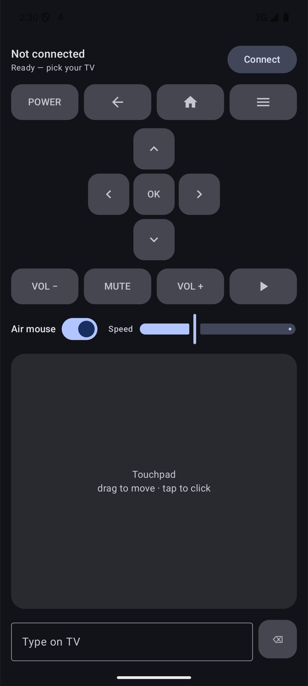

# AirPhone

Use an Android phone as an air mouse + remote for a Xiaomi Mi TV Stick (or any Android TV / Bluetooth HID host).
Nothing to install on the TV: the phone pairs as a standard Bluetooth keyboard + mouse.

**[Website + install](https://harunethm.github.io/airphone/)** · **[Releases](https://github.com/harunethm/airphone/releases)**

<p align="center"></p>

## Features
- **Air mouse**: tilt/turn the phone to move the TV cursor (gyro, works flat or tilted), speed slider.
- **Touchpad**: drag to move, tap to click.
- **Remote**: D-pad + OK, Back, Home, Menu, Power, Volume −/+, Mute, Play/Pause (hold to auto-repeat).
- **Keyboard**: type into the "Type on TV" field and it's typed live on the TV.

## Requirements
- Phone: Android 9+ with the Bluetooth HID Device profile (most phones; some OEM ROMs remove it — the app tells you).
- Gyroscope for air mouse (touchpad works without).

## Install
Open **https://harunethm.github.io/airphone/** on the phone, tap **Download APK**, and allow "install unknown apps"
for the browser once. Or build it yourself:
```sh
./gradlew assembleDebug
adb install -r app/build/outputs/apk/debug/app-debug.apk
```

## Pair (once)
1. Open AirPhone → allow Bluetooth permission.
2. **Connect → Pair new TV…** → allow "make visible" (2 min).
3. On the TV: **Settings → Remotes & Accessories → Add accessory** → pick your phone → confirm the code on both.
4. It connects by itself. Next time it reconnects to the last TV when the app opens.

If the phone was paired with the TV before, unpair it on both sides first.

## Limits
- The link drops while the app is in the background or the phone screen is off (Android unregisters
  background HID apps); it reconnects in a few seconds when you reopen the app. The screen stays on while the app is open.
- Keyboard uses a US layout: Turkish letters are sent as the closest English letter (ş→s, ç→c, ğ→g, ı→i, ö→o, ü→u);
  other characters with no US key (emoji, €) are skipped.
- **Power** sends a sleep/power key; waking the stick from the phone is not guaranteed — use the TV remote/HDMI-CEC.
